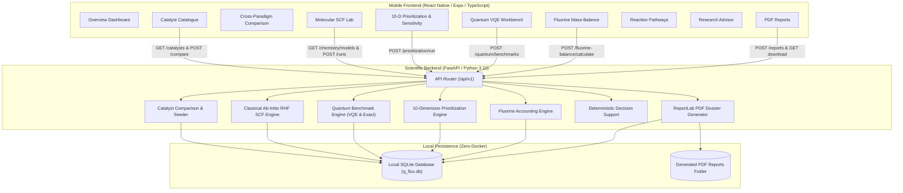

# Q-FLUX 2.0 System Architecture

## Overview
**Q-FLUX 2.0 — Quantum-Guided Catalyst Research, Reaction Pathway Analysis, and Fluorine Recovery** is an end-to-end computational research workbench designed for an international-level quantum hackathon under the theme **“Quantum in Biotechnology & Chemistry”**.

It unites five scientific computational domains:
1. **Evidence-Backed Catalyst Intelligence (Module A & B):** Catalogue of peer-reviewed catalyst systems with side-by-side cross-paradigm comparison and elementary reaction pathway graphs.
2. **Ab-Initio Classical Quantum Chemistry (Module C):** Real electronic-structure engine evaluating Cartesian XYZ coordinates, nuclear point repulsion, RHF/STO-3G SCF ground-state energy, orbital eigenvalues (HOMO-LUMO gap), and reaction energetics ($\Delta E_{rxn}$) for chemically justified PFAS fragments ($CF_3COO^-$, $CH_3F$).
3. **Quantum-Algorithm Workbench (Module D):** 2-qubit Jordan-Wigner mapped C-F bond active-space Hamiltonian and pedagogical toy model solved via Statevector VQE and compared against classical exact diagonalization.
4. **Transparent Catalyst Prioritization (Module E):** 10-dimension multi-criteria decision engine with an explicit missing-defluorination penalty and automated $\pm 20\%$ weight-shift sensitivity analysis.
5. **Fluorine Mass Balance & PDF Dossiers (Module F & G):** Stoichiometric fluoride recovery accounting ($90\%\le \text{Closure} \le 105\%$) and automated ReportLab PDF dossier generation with complete provenance metadata.

---

## 1. High-Level Architecture Diagram

---

## 2. Core Scientific Execution Workflows

### Workflow 1: Classical Ab-Initio Electronic Structure (Module C)
1. User selects chemically justified molecular model:
   - $CF_3COO^-$ (PFOA decarboxylation fragment, 6 atoms, 58 electrons, $q=-1$)
   - $CH_3F$ (Terminal C-F reductive cleavage, 5 atoms, 18 electrons, $q=0$)
2. Backend parses Cartesian XYZ coordinates in Ångströms, verifies interatomic distances, and calculates nuclear point-charge repulsion:
   $$E_{nuc} = \sum_{A < B} \frac{Z_A Z_B}{R_{AB}}$$
3. Executes ab-initio RHF SCF ground state iteration over STO-3G basis set.
4. Computes orbital eigenvalues, HOMO-LUMO gap ($\text{eV}$), dipole moment ($\text{Debye}$), and elementary reaction energy:
   $$\Delta E_{rxn} = E_{product} - E_{reactant}$$
5. Returns converged electronic structure and explicit model scope limitations (gas-phase cluster vs periodic surface).

### Workflow 2: Quantum VQE Active Space vs Exact Diagonalization (Module D)
1. User chooses between:
   - **Reduced C-F Active Space (Molecular):** Jordan-Wigner mapped 2-orbital / 2-qubit Hamiltonian:
     $$H_{CF} = -1.825(II) - 0.680(Z_0) - 0.440(Z_1) + 0.220(Z_0Z_1) + 0.185(X_0X_1) + 0.185(Y_0Y_1)$$
   - **Pedagogical Toy Benchmark:** Parametric test matrix $H_{toy} = c_{z0}(Z_0) + c_{z1}(Z_1) + c_{xx}(XX) + c_{zz}(ZZ)$
2. Solves exact ground state via classical diagonalization (`np.linalg.eigvalsh`).
3. Solves variational ground state via Statevector VQE using hardware-efficient $Ry-Rz-CNOT$ circuit ansatz.
4. Evaluates absolute error $|\Delta E| = |E_{vqe} - E_{exact}|$ and records iterations and evaluations.

### Workflow 3: Multi-Criteria Catalyst Prioritization & Sensitivity (Module E)
1. Evaluates all candidates across 10 normalized dimensions.
2. Applies **Missing Defluorination Penalty** (composite score $\times 0.60$) to any candidate with parent removal $>0\%$ but missing fluoride release.
3. Performs automated sensitivity analysis by perturbing each dimension weight by $\pm 20\%$.
4. Classifies candidates into evidence-grounded statuses (`Evidence-supported`, `Promising but incomplete`, `Mechanistically interesting`, `Insufficient evidence to rank`).

### Workflow 4: Fluorine Mass Balance & PDF Generation (Module F & Report)
1. Enforces mass balance closure:
   $$\text{Defluorination \%} = \frac{[F^-]_{measured}}{[F]_{initial}} \times 100, \quad \text{Closure \%} = \frac{[F^-] + [F]_{organic} + [F]_{byproducts}}{[F]_{initial}} \times 100$$
2. Compiles complete study dossier using ReportLab Platypus into a multi-page PDF with cryptographic hash and verification stamps.

---

## 3. Database Schema (SQLite Normalized Tables)

| Table Name | Purpose | Key Attributes |
|---|---|---|
| `catalysts` | Candidate catalyst database | `id`, `name`, `chemical_formula`, `material_type`, `reported_parent_removal_pct`, `reported_defluorination_pct`, `evidence_category` |
| `molecular_models` | Chemically justified molecular models | `id`, `name`, `chemical_formula`, `charge`, `spin_multiplicity`, `cartesian_coordinates_xyz`, `num_atoms`, `num_electrons`, `basis_set` |
| `classical_chemistry_runs` | Classical ab-initio SCF logs | `id`, `model_id`, `run_name`, `nuclear_repulsion_energy_au`, `total_scf_energy_au`, `homo_lumo_gap_ev`, `reaction_energy_kcal_mol` |
| `prioritization_runs` | 10-D prioritization & sensitivity | `id`, `weights_json`, `rankings_json`, `sensitivity_analysis_json`, `created_at` |
| `quantum_runs` | Quantum VQE execution logs | `id`, `run_name`, `model_type`, `exact_energy`, `vqe_energy`, `absolute_error`, `optimizer_name`, `is_toy_model` |
| `fluorine_balance_scenarios` | Fluorine mass balances | `id`, `scenario_name`, `initial_fluorine_inventory`, `measured_inorganic_fluoride`, `mass_balance_closure_pct`, `closure_status` |
| `pathways` & `pathway_steps` | Reaction mechanism chains | `id`, `reactant_name`, `product_name`, `bond_changes`, `quantum_calc_status` |
| `evidence_records` | Peer-reviewed benchmarks | `id`, `study_title`, `authors`, `doi_or_url`, `parent_removal_pct`, `defluorination_pct`, `verification_status` |
| `reports` | Generated PDF file catalog | `id`, `project_id`, `report_title`, `pdf_filename`, `file_size_bytes` |
